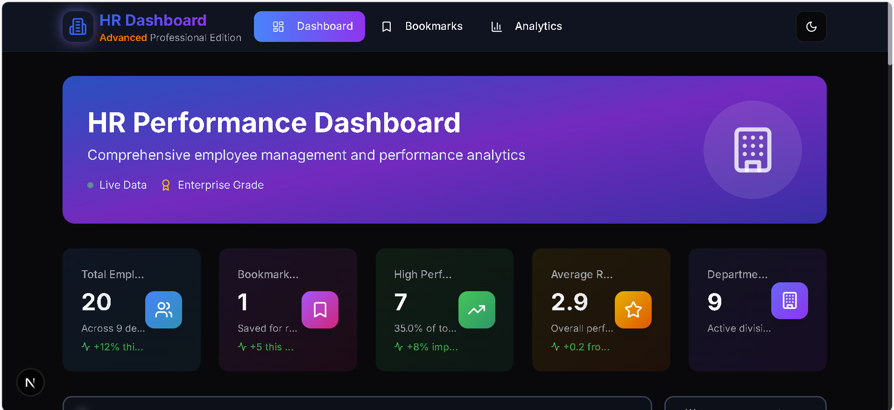
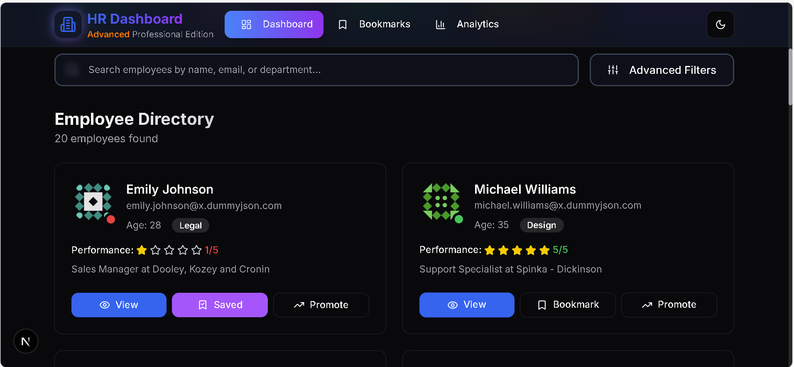
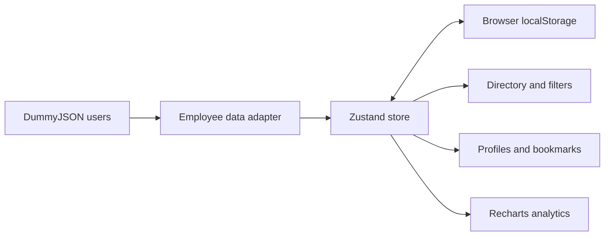

<div align="center">

# HR Performance Dashboard

**Explore employees, save a review list, and understand a team's sample performance data.**

Next.js 15 · React 19 · TypeScript · Zustand · Recharts

[Run locally](#run-locally) · [Features](#features) · [Architecture](#architecture)

</div>

## Purpose

Employee directories, review lists, and performance charts are often separate screens with disconnected state. This project brings them together in a responsive frontend and demonstrates how filtering, persisted bookmarks, and chart views can share the same data.

It is a portfolio and learning application built with sample employee records, not a connected HR information system.

## Preview




## Features

| Screen | What you can do |
|---|---|
| Dashboard | Browse employees and search by name, email, or department. |
| Filters | Narrow results by department and performance rating. |
| Employee profile | Inspect contact details, projects, and feedback. |
| Bookmarks | Keep a persistent shortlist and manage selected employees. |
| Analytics | Compare department ratings and rating distributions with charts. |

The interface includes dark/light themes, loading skeletons, responsive navigation, and toast feedback. Promotion controls and time-series displays are demonstration interactions.

## Run locally

With Node.js/npm installed, open the downloaded source directory:

```bash
npm install
npm run dev
```

Visit [localhost:3000](http://localhost:3000).

For the production build path defined by the project:

```bash
npm run build
npm start
```

## Try the workflow

1. Open the employee directory and search for a name or department.
2. Apply a rating filter and bookmark an employee.
3. Open the employee profile, then the Bookmarks page.
4. Refresh the browser to see the persisted shortlist.
5. Open Analytics to inspect the current sample dataset.

## Architecture



[`lib/api.ts`](lib/api.ts) retrieves sample users and adds generated departments, ratings, projects, and feedback. [`lib/store.ts`](lib/store.ts) owns employee and filter state plus persisted bookmarks. Page components select and display that shared state.

## Project structure

| Path | Responsibility |
|---|---|
| [`app/`](app/) | Dashboard, analytics, bookmarks, and employee routes |
| [`components/`](components/) | Cards, filters, navigation, themes, and UI primitives |
| [`lib/api.ts`](lib/api.ts) | Sample-data fetching and enrichment |
| [`lib/store.ts`](lib/store.ts) | Shared state and persistence |
| [`hooks/`](hooks/) | UI helper hooks |

## Data boundaries

Employee records come from DummyJSON. Performance ratings, projects, feedback, and some chart trends are generated or illustrative. Bookmarks are stored in the current browser; there is no shared employee database or account-based synchronization in this repository. Replace the adapter and persistence layer before using real organizational data.
